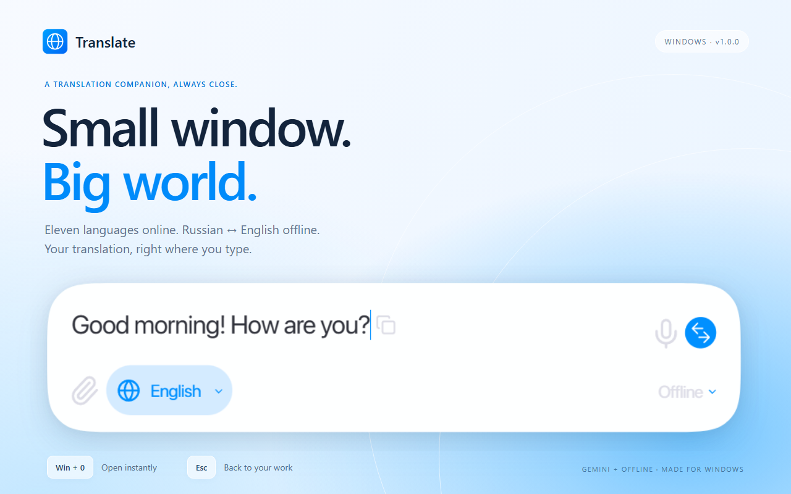
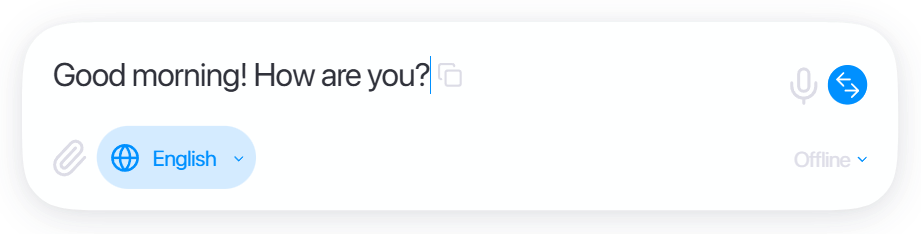
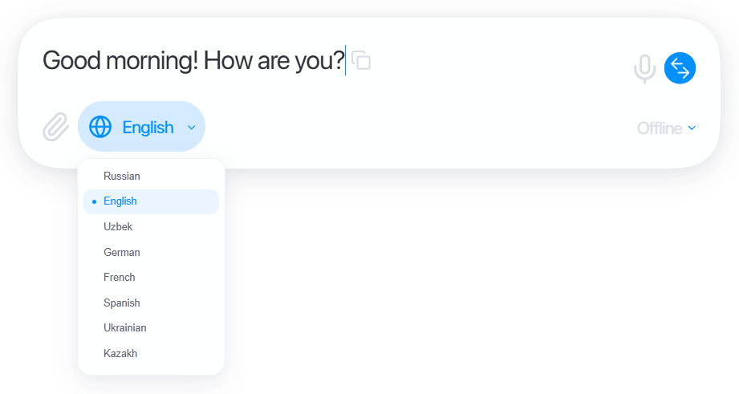
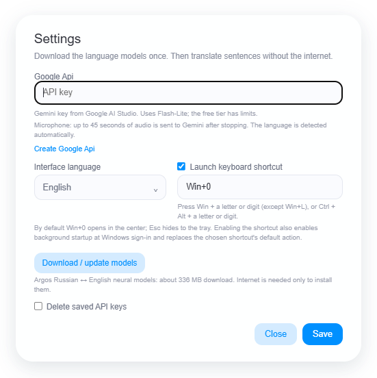

<p align="center">
  
</p>

<p align="center">
  <strong>A compact translation companion for Windows.</strong><br>
  One field. Eleven languages online. Russian ↔ English offline.
</p>

<p align="center">
  <a href="https://github.com/unioneon/Translate/releases/download/v1.0.0/Translate-1.0.0-Setup-x64.exe"></a>
  &nbsp;
  <a href="https://github.com/unioneon/Translate/releases/download/v1.0.0/Translate-1.0.0-Portable-x64.zip"></a>
</p>

<p align="center">
  Windows 10 / 11 · x64 · MIT licensed<br>
  <a href="https://github.com/unioneon/Translate/releases">All releases</a> ·
  <a href="docs/QUICK_START.txt">Quick start</a> ·
  <a href="https://github.com/unioneon/Translate/issues">Report an issue</a>
</p>

## A little less switching. A little more flow.

Press **Win+0**, type a word or a whole sentence, and press **Enter**. The translation takes the place of your text. Copy it, translate it back, or press **Esc** and return to your work.

Translate lives in the system tray. There is no separate result panel and no permanent taskbar button.

| | What you get |
|---|---|
| **One field, one flow** | Your text becomes the translation in the same field. |
| **Google Api mode** | Gemini 3.1 Flash-Lite with your own Google AI Studio key. |
| **Real offline sentences** | Russian ↔ English neural translation on your CPU after a one-time model download. |
| **Voice input** | Record a phrase, stop recording, and let Gemini turn it into editable text. |
| **Quick return** | A reverse-translation button appears after translation. |
| **Small details** | Copy beside the result, clear beside input, quiet menus and a soft shadow. |
| **Your shortcuts** | Customize the launch combination; Esc hides the window without discarding text. |

## Meet the interface

### Your words, translated in place



The arrow becomes a reverse-translation button after success. Copy is right beside the result.

<table>
  <tr>
    <td width="57%" valign="top">
      <h3>Pick your language</h3>
      
      <p>A clean, scrollable list. A blue dot marks your selection.</p>
    </td>
    <td width="43%" valign="top">
      <h3>Make it yours</h3>
      
      <p>Choose the interface language, set your shortcut and manage your own Gemini key.</p>
    </td>
  </tr>
</table>

<sub>Product screenshots captured from the compiled app. The sentence shown above was translated locally, without a cloud request. The cover uses original abstract artwork.</sub>

## Two ways to translate

### Google Api · 11 languages

**Russian · English · Uzbek · German · French · Spanish · Ukrainian · Kazakh · Chinese · Japanese · Korean**

1. Open **Settings → Create Google Api**.
2. Create a Gemini key at [Google AI Studio](https://aistudio.google.com/api-keys).
3. Paste the key into Settings and save.

The app's **Google Api** option uses **Gemini**, not Google Cloud Translation. No key is included. Google's free-tier availability, regional restrictions and quotas depend on your project. Translate does not enable billing or change your plan.

### Offline · Russian ↔ English



Click the gray download arrow beside **Offline** to install the neural language models once, approximately **336 MB**. After that, sentences and paragraphs translate locally through **CTranslate2 + Argos models**. No separate Python installation is needed.

The other nine languages and voice recognition currently use Google Api mode.

## Install or take it with you

| Windows Setup | Portable ZIP |
|---|---|
| Installs for the current Windows user. | Extract the entire ZIP into a writable, permanent folder. |
| Adds a Start-menu entry and Windows uninstaller. | Run `Translate.exe`; keep all bundled files together. |
| Offers an optional desktop shortcut. | No installer required. |
| Checks WebView2 and installs it if missing. | WebView2 must already be installed. |

**Requirements:** Windows 10/11 x64, .NET Framework 4.8 and [Microsoft Edge WebView2 Runtime](https://developer.microsoft.com/microsoft-edge/webview2/). The Setup's optional runtime download and the first Offline model download require internet access. The release executables are currently **unsigned**.

Close an older version from its tray menu before starting a new one. See the [release checksums](https://github.com/unioneon/Translate/releases/download/v1.0.0/SHA256SUMS.txt) to verify your download.

## Keyboard first

| Shortcut | Action |
|---|---|
| **Win+0** | Launch Translate or show the running window, centered. |
| **Esc** | Hide to the tray; keep text and the running process. |
| **Enter** | Translate. |
| **Shift+Enter** | Add a new line. |
| **Ctrl+Z** after translation | Restore the original input. |

Launch shortcuts support **Win + a letter/digit**, excluding Win+L, or **Ctrl+Alt + a letter/digit**. The selected combination replaces its usual Windows action.

**About background launch:** enabling the shortcut also enables startup at Windows sign-in. A small launcher stays running after **Exit**, so the shortcut can start the app again. Disable the shortcut checkbox in Settings to stop the launcher and remove startup. Portable mode uses the same optional integration; it is not a zero-system-changes mode.

## Voice without Windows language packs

Choose Google Api, then click the microphone to start recording. Click again to stop and send the recording to Gemini. Recording ends automatically after **45 seconds**. The detected speech appears in the same editable field; translation is a separate action.

## Your data, your choice

- **Offline:** translation text stays on your computer. Downloading models contacts GitHub and the model host.
- **Google Api:** submitted text is sent to Google when you translate. Recorded audio is sent after recording stops.
- **Your key:** encrypted locally with Windows DPAPI for the current Windows user. No key is bundled in this repository or the release.
- **Your keyboard:** the launcher matches the chosen shortcut; it does not log or transmit keystrokes.

Settings, the WebView2 profile and downloaded models live beside the executable. Hotkey integration also stores a small launcher configuration in `%LOCALAPPDATA%\TranslateFloating` and a per-user startup shortcut. Uninstalling may leave generated settings/profile files and downloaded models in the app folder.

## Build from source

On Windows, install **PowerShell 7** and **Node.js**, then run:

```powershell
pwsh .\scripts\build.ps1 -Installer
```

The script downloads pinned, SHA-256-verified Python/PyPI/NuGet dependencies, creates the app icon, compiles the WPF/WebView2 host, and packages Setup plus Portable ZIP in `dist/`. With `-Installer`, it also installs a verified Inno Setup compiler inside `.tools/`.

The build stages an explicit file allowlist. API settings, WebView2 profiles, recordings, model weights and local test executables are excluded from distributions. See [development notes](docs/DEVELOPMENT.md) for tests and the release layout.

## Credits & license

Made by [unioneon](https://github.com/unioneon). Translate's source and original artwork are [MIT licensed](LICENSE).

Built with WPF, Microsoft WebView2, Python, CTranslate2 and SentencePiece. Offline model packages come from the Argos ecosystem. Third-party licenses and model notices remain separate; see [THIRD_PARTY_NOTICES.md](THIRD_PARTY_NOTICES.md).
