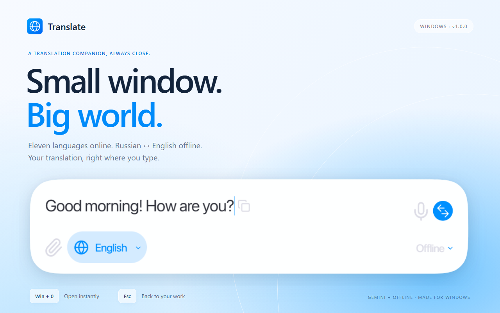

# Translate 1.0.0

**Small window. Big world.** The first public release of Translate, a compact Windows translation companion that stays close to your work.

## Choose your download

- **`Translate-1.0.0-Setup-x64.exe`** — installs for the current Windows user, adds Start-menu and uninstall entries, and checks WebView2.
- **`Translate-1.0.0-Portable-x64.zip`** — extract the complete `Translate` folder and run `Translate.exe`.
- **`SHA256SUMS.txt`** — checksums for both downloads.

## Inside this release

- One-field translation: your result replaces the input.
- Eleven languages through Gemini with your own Google AI Studio key.
- Full-sentence Russian↔English Offline translation with downloadable Argos neural models.
- Voice-to-text through Gemini, with a visible recording state and a 45-second limit.
- Reverse translation, inline copy/clear actions and blue selection dots.
- Tray-first operation, Win+0 to open and Esc to hide.
- Customizable launch shortcuts and system-aware English/Russian interface selection.

## Before you start

Windows 10/11 x64, .NET Framework 4.8 and WebView2 are required. Python is bundled. The first Offline model download is approximately 336 MB. No API key or model weights are included.

**Google Api means Gemini**, not Google Cloud Translation. Google's free-tier quotas, project eligibility and regional availability apply. Translate does not enable billing.

Enabling the launch shortcut also enables background startup at Windows sign-in. The small launcher remains after Exit so the shortcut can launch the closed app. Disable the shortcut checkbox in Settings to turn this off. Portable mode supports the same optional integration.

The release executables are unsigned. Close an older version through its tray menu before running a new copy.

[Read the guide](https://github.com/unioneon/Translate#readme) · [Report an issue](https://github.com/unioneon/Translate/issues)
