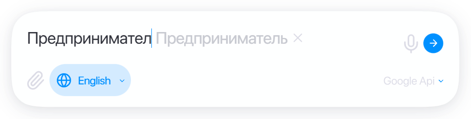

# Translate 1.1.0

Spelling suggestions now appear beside your words, in the same field.

- Gemini checks spelling after a 1.1-second pause in Google Api mode.
- Input language is detected automatically: Russian, English, Uzbek, German, French, Spanish, Ukrainian, Kazakh, Chinese, Japanese and Korean.
- Click a gray suggestion to replace that word. Ctrl+Z restores the original.
- Unaccepted suggestions never enter your copied text or translation.
- Checks pause during IME composition and ignore outdated responses.
- Settings includes a switch to disable spelling checks.

**Privacy:** spelling is enabled by default. It sends the full draft (up to 5,000 characters) to Google using your own Gemini key. Offline mode makes no cloud spelling requests. No API key is bundled. Google's quotas and regional restrictions apply.

The screenshot shows the compiled interface with a test response. Parser and native WebView2 interaction checks passed; live Gemini validation requires an active key.

Choose **Setup** to install or extract the entire **Portable ZIP**. Windows 10/11 x64, .NET Framework 4.8 and WebView2 are required. These executables are unsigned.
